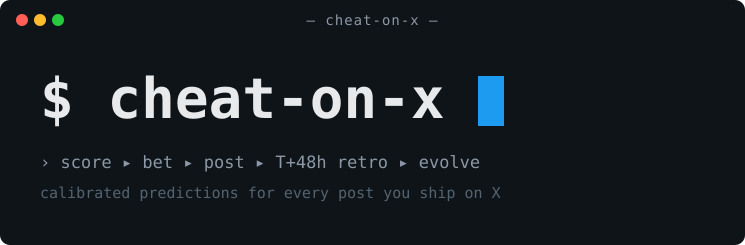

<h1 align="center">
  
</h1>

<h2 align="center">Cheat on X</h2>

<p align="center">
  <strong>English</strong>
  &nbsp;·&nbsp;
  <a href="docs/README_CN.md"><strong>简体中文</strong></a>
</p>

<p align="center">
<a href="CHANGELOG.md"></a>
&nbsp;
<a href="LICENSE"></a>
&nbsp;
<a href="https://github.com/XBuilderLAB/cheat-on-content"></a>
</p>

<p align="center">
The X (Twitter) edition of <a href="https://github.com/XBuilderLAB/cheat-on-content">cheat-on-content</a>:<br>
every post you ship becomes a bet you wrote down <em>before</em> the numbers showed up.
</p>

---

## ⚡ Start in one sentence

Give this repo's link to any agent that can work with files and run commands (Claude Code, Codex, Cursor, Gemini CLI…) and say:

```
启动 cheat-on-x        (or: start cheat-on-x)
```

The agent follows [START.md](START.md). It installs the skills, creates a workspace for your posts (default `~/x-posts`), and asks you three questions. After that you just talk:

| You say | The agent does |
|---|---|
| *(pastes a draft)* "how's this?" | saves it, scores it, points at the one or two things to fix |
| "ok, posting now" | writes a blind bet and locks it, **then** tells you to post |
| "posted https://x.com/you/status/…" | registers it and tells you when the 48h retro is due |
| "how did it do?" | finds the CSV you just exported in Downloads and retros only the posts that are due |
| "what should I post today?" | recommends from your topic pool, or drafts something |

You never have to remember a command or a file path. The workspace gets an `AGENTS.md` / `CLAUDE.md`, so the next time you open an agent there it picks up where you left off. The 15 `/cheatx-*` slash commands are still there if you prefer them.

---

## 🎬 What it does

Most people on X are stuck in the same loop:

> Post → watch the counter → learn nothing → post again

**Cheat on X** makes every judgment get written down, settled against the data, and folded back into the next one:

📊 Score → 🎯 Blind-bet → 🚀 Post → 📈 T+48h retro → 🧬 Evolve your rubric

The method is cheat-on-content's. Everything that touches the platform is rebuilt for X.

---

## 🧭 Why X needs its own version

| | cheat-on-content (video) | Cheat on X |
|---|---|---|
| Unit | one video | one post: single / thread / long post / Article / quote / reply |
| Cadence | a few videos a week, "shot" vs "published" | several posts a day; **quick bets** and **batch predict / batch retro** |
| Retro window | T+3d | **T+48h** (For You drops candidates older than 48h); long posts & Articles T+7d |
| Rubric | opinion-video dimensions (emotion, hook, quotable lines…) | 8 dimensions mapped to the actions X's ranker predicts (below) |
| Buckets | absolute / ratio | multiples of **your own per-form baseline** (median of your last 10 posts of that form) |
| Data | logged-in browser scrapers per platform | **userscript CSV export** (free, default) · X API (optional, pay-per-use) · paste |
| Covariates | — | posting hour, gap since your last post, Premium, link, media, followers — recorded on every bet |

## 🧠 Dimensions grounded in X's ranker

X open-sourced its For You ranker in Jan 2026 ([xai-org/x-algorithm](https://github.com/xai-org/x-algorithm)). Its Phoenix model predicts a probability for each user action on a candidate post, then takes a weighted sum. The weights aren't published, so v0 doesn't pretend to know them: seven positive dimensions are equal-weighted, negative feedback is a penalty, and **your own retros** decide the real weights.

| Dimension | Actions it targets |
|---|---|
| HK Hook | dwell, click into the post, photo expand / "not dwelled" |
| RP Reply pull | reply (and the author replying back) |
| SV Save & send | share via DM / copy link, bookmark |
| RS Repost & quote | repost, quote |
| DW Dwell | dwell time |
| FT Follow trigger | profile click, follow author |
| NF Niche fit | in-network reach + embedding retrieval for out-of-network |
| NR Negative risk (penalty) | not interested, mute, block, report |

```
v0 composite = (HK + RP + SV + RS + DW + FT + NF) / 7 × 2 − NR × 0.4
```

---

## 🛡️ The three rules (unchanged from upstream, enforced harder)

1. **Blind prediction.** The bet is written before you hit Post. The body of every prediction file (scores, bucket, reasoning, anchors, counterfactuals) is locked by a PreToolUse hook that **exits 2**, so the edit is actually blocked.
2. **Bump = full re-score.** Changing the formula means re-scoring the calibration pool with a context-isolated blind sub-agent. Then `tools/rank_check.py` must show a Spearman gain that holds in ≥80% of bootstrap resamples with no per-form regression, and a different model has to audit the change.
3. **The rubric is a workbench, not a museum.** Observations with real numbers live in `rubric-memo.md`. `rubric_notes.md` stays abstract, because it is the only file the blind scorer reads, and `tools/leak_check.py` guards it.

---

## 📦 Manual install

If you'd rather do it yourself than have an agent follow [START.md](START.md):

```bash
git clone <this-repo-url> ~/cheat-on-x
cd ~/cheat-on-x
bash install.sh            # Claude Code   (--codex for Codex, --all for both; --yes never prompts)
```

This links the `cheat-on-x` entry skill plus fifteen `/cheatx-*` slash commands into your agent's skill directory. They can sit next to upstream `cheat-*` skills without clashing. Then open a new agent session and say `启动 cheat-on-x`.

`/cheatx-init — mode: full` runs the original eight-question onboarding (handle and Premium, forms, language, posts per day, history, data route, topic pool, hooks) instead of the three-question quick start.

**Data export (recommended):** install [`userscripts/cheatx-exporter.user.js`](userscripts/README.md) in Tampermonkey or Violentmonkey. While you browse x.com it reads the data the page already loaded, and one click exports a CSV. It sends no extra requests and uploads nothing. The agent finds the file in your Downloads folder on its own.

## ⌨️ Slash commands (optional)

```
/cheatx-score · /cheatx-predict (quick / full / batch) · /cheatx-queue · /cheatx-publish
/cheatx-retro · /cheatx-status · /cheatx-recommend · /cheatx-seed · /cheatx-trends
/cheatx-learn-from · /cheatx-persona · /cheatx-bump · /cheatx-init · /cheatx-migrate
```

---

## ⚠️ Honest limitations

- **No calibrated X rubric ships with this.** Upstream's opinion-video rubric was fitted on 25+ real videos. The X rubric is a v0 prior built from the ranking code, not from data. Expect ±60% on your first bets.
- The userscript relies on the shape of X's GraphQL responses. It's tested on synthetic fixtures; try it once on your own account before relying on it.
- X Analytics CSV column names come from common export formats, not from a verified 2026 export. If yours don't map, run `import_csv.py inspect` and add `--map`.
- X API prices in `xapi.py` come from third-party summaries. Check docs.x.com.
- Managed mode is instructions, not code. How well "just talk to it" works depends on the agent following `SKILL.md`. It needs an agent that can read and write files; a plain web chat can only score drafts.
- The prediction lock is enforced only in Claude Code (a hook). Other agents rely on the rules plus a git commit after every bet, so later edits show up in `git diff`.

## 🧪 Tests

```bash
python -m unittest discover -s adapters/perf-data/x-csv-import -p "test_*.py"
python -m unittest discover -s adapters/perf-data/x-api -p "test_*.py"
python -m unittest discover -s tools -p "test_*.py"
python -m unittest discover -s hooks -p "test_*.py"        # needs bash (Git Bash on Windows)
node --test userscripts/test/exporter.test.js
```

---

## 📜 License & credit

MIT. Derived from [XBuilderLAB/cheat-on-content](https://github.com/XBuilderLAB/cheat-on-content) (MIT), whose method, protocols and blind-scoring design this edition keeps. [docs/removals.md](docs/removals.md) lists what was removed for X and where upstream keeps it.
