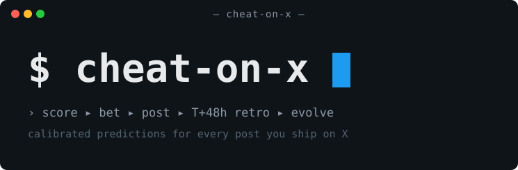

<h1 align="center">
  
</h1>

<h2 align="center">Cheat on X · 推特作弊器</h2>

<p align="center">
  <a href="../README.md"><strong>English</strong></a>
  &nbsp;·&nbsp;
  <strong>简体中文</strong>
</p>

<p align="center">
<a href="../CHANGELOG.md"></a>
&nbsp;
<a href="../LICENSE"></a>
&nbsp;
<a href="https://github.com/XBuilderLAB/cheat-on-content"></a>
</p>

<p align="center">
<a href="https://github.com/XBuilderLAB/cheat-on-content">cheat-on-content</a> 的 X（推特）版：<br>
你在 X 上发的每一条，都是一个在数字出来<b>之前</b>就写下来的赌注。
</p>

---

## 🎬 它在干什么

大部分人在 X 上的循环是：

> 发帖 → 盯着浏览数 → 什么也没学到 → 再发一条

**Cheat on X** 让每一次判断都被写下来、用数据结算、再吸收进下一次：

📊 打分 → 🎯 盲押 → 🚀 发帖 → 📈 T+48h 复盘 → 🧬 进化你的评分公式

方法论来自 cheat-on-content；所有和平台有关的部分都为 X 重做了。

---

## 🧭 为什么 X 需要单独一个版本

| | cheat-on-content（视频） | Cheat on X |
|---|---|---|
| 单位 | 一条视频 | 一条帖子：单帖 / thread / 长帖 / Article / 引用 / 回复 |
| 节奏 | 一周几条，"拍了"和"发了"分开 | 一天几条；**快押**、**批量预测**、**批量复盘** |
| 复盘窗口 | T+3d | **T+48h**（For You 的候选过滤会丢掉 48 小时以前的帖子）；长帖 / Article T+7d |
| rubric | 观点视频维度（情感、钩子、金句……） | 8 维，对齐 X 推荐算法预测的用户行为（见下） |
| 预测区间 | 绝对数 / 比率 | **你自己每种形态的基线**（该形态最近 10 条的曝光中位数）的倍数 |
| 数据 | 各平台登录态浏览器抓取 | **油猴脚本导出 CSV**（默认、免费）· X API（可选、按量计费）· 手动粘贴 |
| 协变量 | — | 发帖时段、距上一条间隔、Premium、外链、媒体、粉丝数——每次下注都记录 |

## 🧠 维度对齐 X 的推荐算法

X 在 2026 年 1 月开源了 For You 排序（[xai-org/x-algorithm](https://github.com/xai-org/x-algorithm)）：Phoenix 模型给每条候选帖预测一组用户行为的概率，再加权求和。权重没有公开，所以 v0 不假装知道：7 个正向维度等权，负反馈单独扣分；真实权重由**你自己的复盘**反推。

| 维度 | 对应的行为 |
|---|---|
| HK 首屏钩子 | 停留、点进帖子、展开图片 / 没停留就划走 |
| RP 回复牵引 | 回复（以及作者回复回复） |
| SV 收藏私信 | 私信 / 复制链接分享、收藏 |
| RS 转引身份 | 转发、引用 |
| DW 停留密度 | 停留时长 |
| FT 关注转化 | 点主页、关注作者 |
| NF 圈层契合 | 关注者时间线 + 圈外的向量检索 |
| NR 负反馈风险（扣分） | 不感兴趣、静音、屏蔽、举报 |

```
v0 composite = (HK + RP + SV + RS + DW + FT + NF) / 7 × 2 − NR × 0.4
```

---

## 🛡️ 三条原则（和上游一样，执行得更硬）

1. **盲预测**：在点"发布"之前写下赌注。预测文件的主体（分数、区间、推理、锚点、反事实）由 PreToolUse hook 锁定。hook 用 **exit 2** 退出，所以编辑是真的被拦下来。
2. **升级 = 全量重打**：换公式要先用上下文隔离的盲打 sub-agent 重打校准池。然后 `tools/rank_check.py` 要证明 Spearman 提升，并且这个提升在 ≥80% 的自助重采样里成立、没有任何形态退步。最后还要经过另一个模型审核。
3. **rubric 是工作台，不是博物馆**：带真实数字的观察放在 `rubric-memo.md`。`rubric_notes.md` 只放抽象规则，因为它是盲打 sub-agent 唯一能读的文件，由 `tools/leak_check.py` 把守。

---

## 📦 安装

```bash
git clone <本仓库地址> cheat-on-x
cd cheat-on-x
bash install.sh            # Claude Code（--codex 装到 Codex，--all 两个都装）
```

15 个 `cheatx-*` skill 会链接进 agent 的 skill 目录，可以和上游的 `cheat-*` 并存。

**数据导出（推荐）**：在篡改猴 / 暴力猴里装 [`userscripts/cheatx-exporter.user.js`](../userscripts/README.md)。你浏览 x.com 时，它读页面已经加载的数据，点一下就导出 CSV；不发额外请求，不上传任何东西。

---

## 🚀 第一次用

为你的 X 账号建一个空文件夹，在里面打开 Claude Code，说：

```
初始化 cheat-on-x
```

它会问 8 个问题（handle 与 Premium、常发形态、语言、每天几条、历史、数据路线、选题池、hooks），可以导入你最近的帖子算出各形态基线，再导入一个对标账号。

## ⚡ 日常

```
找选题 / "帮我写一条关于 X 的"           → drafts/…
快押 drafts/… ｜ 启动预测 … ｜ 批量预测 drafts/
定稿 drafts/…                           → 进队列
已发 https://x.com/你/status/…           → 登记发布、排好复盘时间
复盘到期的 imports/cheatx-mine-….csv     → 一次复盘所有到期的帖子
X 状态 · 推荐今天发什么 · 抓 X 热点 · 升级 rubric · 导入对标账号 @someone
```

---

## ⚠️ 诚实的局限

- **没有自带校准过的 X rubric**。上游的观点视频 rubric 是用 25+ 条真实视频拟合的；X 版 v0 是从排序代码推出来的先验，不是数据。头几条预测 ±60% 是正常的。
- 油猴脚本依赖 X 的 GraphQL 响应结构。目前只在合成数据上测过，正式依赖之前先在自己账号上试一次。
- X Analytics 导出的列名来自常见格式，没有用 2026 年的真实导出验证过。对不上就 `import_csv.py inspect`，再加 `--map`。
- `xapi.py` 里的 API 单价来自第三方汇总，以 docs.x.com 为准。

## 🧪 测试

```bash
python -m unittest discover -s adapters/perf-data/x-csv-import -p "test_*.py"
python -m unittest discover -s adapters/perf-data/x-api -p "test_*.py"
python -m unittest discover -s tools -p "test_*.py"
python -m unittest discover -s hooks -p "test_*.py"        # 需要 bash（Windows 用 Git Bash）
node --test userscripts/test/exporter.test.js
```

---

## 📜 License 与致谢

MIT。派生自 [XBuilderLAB/cheat-on-content](https://github.com/XBuilderLAB/cheat-on-content)（MIT）。本版保留了它的方法论、协议和盲打设计。为 X 移除了哪些内容、上游在哪里保留，见 [docs/removals.md](removals.md)。
